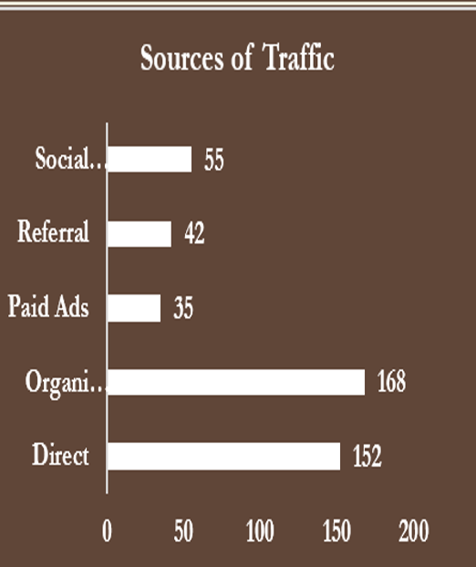
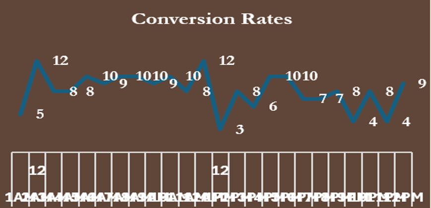

# Brightcart Ecommerce Performance 

## Introduction 

BrightCart Online Retail is a fast-growing e-commerce company specializing in consumer electronics, home goods, and lifestyle products. Founded in 2010 by a group of tech entrepreneurs, BrightCart aimed to simplify online shopping by offering an intuitive, personalized shopping experience with fast delivery and competitive pricing. 

Growth Journey & Milestones:

2012: Expanded to nationwide shipping, achieving a customer base of 500,000.

2015: Launched a mobile app with AI-based product recommendations, boosting repeat purchases by 20%.

2018: Reached a lot of active monthly users, ranking among the top 20 online retail platforms in the U.S.

2021: Integrated social commerce and live shopping features, improving engagement and conversion rates.

2023: Introduced sustainable packaging options, appealing to eco-conscious shoppers.

## Problem Statement

BrightCart experiences significant fluctuations in website traffic depending on the time of day, day of the week, and marketing campaign timing. The company also lacks comprehensive insights into the sources of this traffic—whether users are coming from organic search, paid ads, social media, or email campaigns. 
    
### Key Challenges:

Traffic Timing Uncertainty: Without analyzing peak engagement hours, BrightCart struggles to schedule promotions, email campaigns, and website updates effectively.

Traffic Source Analysis: Marketing resources are not optimally allocated because the company cannot accurately measure the ROI of each traffic source.

Conversion Optimization: High traffic at suboptimal times may not convert efficiently, leading to wasted marketing spend.

Customer Behavior Insights: Limited understanding of when and from where customers interact with the platform reduces the effectiveness of personalization and targeted promotions.

## Project Objectives

- Identify peak traffic times and low-traffic periods to schedule marketing efforts effectively.

- Analyze the sources of traffic (organic, paid, social, email) to measure channel effectiveness.

- Correlate traffic timing with conversion rates to optimize promotional campaigns.

- Segment traffic patterns by customer demographics and geographies for targeted marketing.

- Provide actionable recommendations to improve ROI from traffic sources and enhance overall website performance.

  ## Data Collection & Preparation 

  The data for this project was collected and cleaned using power query on MS Excel.
  The data contains 500 rows and 10 columns. The ,major columns includes but not limited to , Order ID, ......

  ### Data Cleaning
  (mention the errors in the data and how they were cleaned)

  ## Data Analysis & Visualisation

  Having cleaned the data, the data was analysed and the analysis and insights are as follows -

  **Sources of Traffic**

   

Organic Search is the highest  source of traffic with 168 searches followed by Direct search with 152 searches while Paid Ads is the least traffic source with 35 searches

**Conversion Rates**

- Across the traffic sources, less than 50% conversions were made.
- Many people checked the sight without checking out.
- The highest source of traffic – Organic Search – has the highest conversion.

